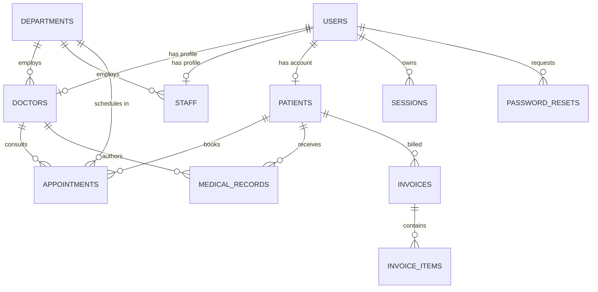

<p align="center">
  
</p>

<h3 align="center">Enterprise Healthcare Operating System &amp; Clinical Administration Platform</h3>

<p align="center">
  A full-stack hospital and clinical practice administration suite engineered for modern healthcare facilities — featuring role-based clinical workflows, electronic health records (EMR), automated invoicing, real-time analytics telemetry, and an isolated cybersecurity penetration-testing lab.
</p>

<p align="center">
  
  
  
  
  
  
</p>

---

## Table of Contents

- [Overview](#overview)
- [Key Features](#key-features)
- [System Architecture](#system-architecture)
- [Database Schema (ERD)](#database-schema-erd)
- [Role-Based Access Control (RBAC)](#role-based-access-control-rbac)
- [Application Security Architecture](#application-security-architecture)
- [Isolated Security Lab (Educational Penetration Testing)](#isolated-security-lab-educational-penetration-testing)
- [Technology Stack](#technology-stack)
- [Installation & Setup](#installation--setup)
- [Pre-Configured Test Accounts](#pre-configured-test-accounts)
- [Running Automated Tests](#running-automated-tests)
- [Project Directory Structure](#project-directory-structure)
- [Contributing](#contributing)
- [License](#license)

---

## Overview

**MediCore** is a comprehensive hospital information management platform designed to unify administrative, clinical, and patient-facing workflows into a secure, responsive interface styled with a modern Black &amp; Clinical Green theme (`#0F172A` &amp; `#16A34A` / `#22C55E`).

The platform provides role-segregated portals for:
1. **System Administrators (Ardhra)**: System-wide governance, staff and doctor onboarding, department configuration, and clinical oversight.
2. **Physicians &amp; Specialists**: Daily appointment rosters, longitudinal patient health history, clinical progress note authoring, and electronic prescriptions (EMR).
3. **Front Desk &amp; Receptionists**: Patient intake, appointment booking, rescheduling, and billing invoicing.
4. **Patients**: Self-service appointment booking, upcoming visit tracking, and confidential access to personal medical records.

In addition to hardened production authentication, MediCore includes an **isolated cybersecurity lab** containing two intentionally vulnerable authentication mechanisms for authorized penetration testing, vulnerability assessment, and educational training.

---

## Key Features

### 1. Clinical Operations &amp; Electronic Medical Records (EMR)
- **Patient Registry &amp; Search**: Filterable directory by name, phone, locality, blood group, and gender.
- **Doctor &amp; Specialist Roster**: Clinical credentialing across Cardiology, Pediatrics, Orthopedics, Dermatology, and General Medicine.
- **Appointment Scheduling**: Multi-state appointment lifecycle (`pending` &rarr; `confirmed` &rarr; `completed` / `cancelled`).
- **Electronic Health Records**: Structured clinical progress notes, diagnostic summaries, and physician prescriptions.

### 2. Hospital Governance &amp; Administration
- **Department Hierarchy**: Organizational unit management with real-time staff, physician, and appointment counts.
- **Staff Credentialing**: Role assignments for receptionists, triage nurses, and intake coordinators.
- **Patient Billing &amp; Invoicing**: Itemized medical services, GSTIN tax calculations, invoice state tracking (`unpaid`, `paid`, `overdue`), and printable receipts.

### 3. Analytics &amp; Reporting
- **Caseload Telemetry**: Interactive Chart.js doughnut visualizations of appointment distribution.
- **Specialist Workload Metrics**: Breakdown of patient visits and completion rates per physician.
- **Data Export**: One-click CSV generation for Appointments, Invoices, and Patient directories.

---

## System Architecture

```mermaid
graph TD
    Client["Web Browser Client"] --> WebServer["Flask Application Engine (WSGI)"]
    WebServer --> SecMiddleware["Security & Auth Middleware\n(CSPRNG Sessions, Rate Limiting, RBAC Guards)"]
    SecMiddleware --> AppBlueprints["Production Modules\n(Patients, Doctors, Appointments, EMR, Billing, Reports)"]
    SecMiddleware -. "SECURITY_LAB_ENABLED=1\nHost: 127.0.0.1 / localhost" .-> SecurityLab["Isolated Security Lab\n(CWE-640 & CWE-384 Blueprints)"]
    AppBlueprints --> ProdDB[("SQLite Database\nmedicore.db (10 Relational Tables)")]
    SecurityLab --> LabDB[("Lab Tables\nvuln_reset_tokens, vuln_sessions")]
```

---

## Database Schema (ERD)



---

## Role-Based Access Control (RBAC)

MediCore enforces strict server-side authorization checks on every endpoint using `@login_required` and `@roles_required` decorators:

| Capability / Route | Administrator (`admin`) | Physician (`doctor`) | Receptionist (`receptionist`) | Patient (`patient`) |
|---|:---:|:---:|:---:|:---:|
| System Dashboard &amp; Clinical Overview | &#10004; | &#10004; | &#10004; | &#10004; *(Personalized)* |
| Manage Staff &amp; Doctors (`/staff`, `/doctors`) | &#10004; | &#10008; | &#10008; | &#10008; |
| Manage Clinical Departments (`/departments`) | &#10004; | View Only | View Only | View Only |
| Patient Intake &amp; Registration | &#10004; | &#10004; | &#10004; | Self-Register |
| Patient Directory Search (`/patients/`) | &#10004; | &#10004; | &#10004; | &#10008; *(Own Profile Only)* |
| View Patient Medical Records (`/records/`) | &#10004; | &#10004; | &#10008; | &#10008; *(Own Record Only)* |
| Author Medical Record / Prescription | &#10004; | &#10004; | &#10008; | &#10008; |
| Schedule &amp; Update Appointments | &#10004; | Status Only | &#10004; | Self-Book Only |
| Billing &amp; Invoices (`/billing`) | &#10004; | &#10008; | &#10004; | View Own Invoice |
| System Reports &amp; CSV Exports | &#10004; | &#10008; | &#10004; | &#10008; |

---

## Application Security Architecture

### 1. Password Security
- Passwords are never stored in plaintext. Passwords are salted and hashed using PBKDF2-HMAC-SHA256 (`werkzeug.security`) with 600,000 iterations.
- Minimum password length of 8 characters enforced at registration, password reset, and user creation.

### 2. Session Management
- Session tokens are generated using `secrets.token_urlsafe(32)` providing 256 bits of CSPRNG entropy.
- Tokens are stored server-side in the `sessions` table and verified against active user status.
- Cookies are transmitted with `HttpOnly=True`, `SameSite=Lax`, and `Secure=True` when behind TLS.
- Password change automatically revokes all other active sessions for that user account.

### 3. Server-Side Login Rate Limiting
- MediCore tracks login failures per email and client IP (`_LOGIN_ATTEMPTS`).
- After **5 consecutive failed attempts**, login requests for that key are locked out for **15 minutes**.
- Rate limiting is enforced server-side in memory and cannot be bypassed by clearing cookies or opening private browsing windows.

### 4. Cross-Site Request Forgery (CSRF) Protection
- State-changing `POST` requests require a valid cryptographic CSRF token generated via `Flask-WTF`.
- CSRF tokens are injected automatically into forms and validated on submission.

### 5. Injection Prevention &amp; Output Encoding
- **SQL Injection**: All database operations use SQLite parameterized queries (`?` placeholders) through Python's `sqlite3` cursor. No user input is directly concatenated into SQL.
- **Cross-Site Scripting (XSS)**: Jinja2 autoescaping is active across all templates.

### 6. Security Headers
The application automatically attaches defense-in-depth HTTP security headers to every response:
- `X-Frame-Options: SAMEORIGIN` (prevents clickjacking)
- `X-Content-Type-Options: nosniff` (prevents MIME type sniffing)
- `X-XSS-Protection: 1; mode=block`
- `Referrer-Policy: strict-origin-when-cross-origin`

---

## Isolated Security Lab (Educational Penetration Testing)

MediCore houses two intentionally vulnerable authentication implementations located in `security_lab/`. These exist exclusively for security researchers, students, and penetration testers to understand real-world authentication flaws.

### Lab Safety Guardrails
- **Disabled by default**: `SECURITY_LAB_ENABLED=0` in `config.py` and `.env`.
- **Localhost Bound**: A `before_request` hook returns HTTP 403 Forbidden if the request `Host` is not `127.0.0.1` or `localhost`.
- **Data Isolation**: The lab maintains its own separate tables (`vuln_reset_tokens`, `vuln_sessions`) and never shares state with production authentication.

### Vulnerability 1: Weak Password Recovery (CWE-640, CWE-330)
- **Endpoint**: `/lab/password-recovery/forgot-password` &amp; `/lab/password-recovery/reset/<token>`
- **Flaw**: Reset tokens are computed using deterministic string formatting:
  ```python
  # security_lab/broken_password_recovery/routes.py
  now = datetime.utcnow()
  user_part = f"{user['id'] % 100:02d}"
  time_part = f"{now.hour * 60 + now.minute:04d}"
  token = f"{user_part}{time_part}"  # Only 6 digits; easily guessable!
  ```
- **Remediation**: Use `secrets.token_urlsafe(32)`, store only a SHA-256 hash in the database, set an expiry timestamp (15 minutes), and mark single-use upon redemption (as implemented in `app/auth/routes.py`).

### Vulnerability 2: Insecure Session Management (CWE-384, CWE-330)
- **Endpoint**: `/lab/session-demo/login` &amp; `/lab/session-demo/whoami`
- **Flaw**: The session cookie (`lab_session`) is set directly to the sequential auto-incrementing integer primary key from the `vuln_sessions` table, lacking `HttpOnly` and `SameSite` flags.
- **Remediation**: Issue high-entropy 256-bit CSPRNG tokens, store them server-side, and configure `HttpOnly=True`, `SameSite=Lax`, and `Secure=True` cookies.

For complete reproduction walkthroughs, refer to [`docs/security_testing.md`](docs/security_testing.md).

---

## Technology Stack

| Layer | Component | Notes |
|---|---|---|
| **Frontend** | HTML5, Modern CSS3, JavaScript (ES6+) | Black &amp; Clinical Green palette (`#0F172A`, `#16A34A`), responsive sidebar |
| **Styling** | Custom CSS + Bootstrap 5.3 | Responsive flexbox/grid layout, modern clinical design system |
| **Icons** | Bootstrap Icons 1.11 | Full CRUD action icons (Add, Edit, View, Delete, Filter, Search) |
| **Visualizations** | Chart.js 4.4 | Real-time clinical appointment telemetry |
| **Backend** | Python 3.9+, Flask 3.0+ | Modular Flask Blueprint architecture |
| **Security** | Werkzeug 3.0+ | PBKDF2-HMAC-SHA256 password hashing, CSPRNG tokens, rate limiting |
| **Database** | SQLite 3 | 10 relational tables with cascading foreign keys (`PRAGMA foreign_keys = ON`) |
| **Testing** | Python `unittest` &amp; `pytest` | 19 automated tests covering auth, RBAC, CRUD, and lab flows |

---

## Installation &amp; Setup

### Prerequisites
- Python 3.9, 3.10, 3.11, or 3.12
- Git

### 1. Clone the Repository
```bash
git clone https://github.com/ardhra14/MediCore.git
cd MediCore
```

### 2. Set Up Virtual Environment

**On Windows (PowerShell):**
```powershell
python -m venv .venv
.\.venv\Scripts\activate
```

**On macOS / Linux:**
```bash
python3 -m venv .venv
source .venv/bin/activate
```

### 3. Install Dependencies
```bash
pip install -r requirements.txt
```

### 4. Configure Environment Variables
```bash
# Windows PowerShell
Copy-Item .env.example .env

# macOS / Linux
cp .env.example .env
```
*(The default configuration in `.env.example` is ready for immediate local testing).*

### 5. Seed the Database
```bash
python database/seed.py
```
This initializes the database schema from `database/schema.sql` and loads realistic Indian (Malayali) healthcare provider profiles, clinical departments, appointments, and medical records.

### 6. Run the Application
```bash
python run.py
```
Open your browser and navigate to: **http://127.0.0.1:5000**

---

## Pre-Configured Test Accounts

All pre-seeded test accounts use the password: **`Passw0rd!`**

| Role | Name | Email Address | Department / Title |
|---|---|---|---|
| **Administrator** | Ardhra | `admin@medicore.test` | System Administration &amp; Hospital Management |
| **Doctor** | Dr. Harikrishnan Nair | `dr.harikrishnan@medicore.test` | Interventional Cardiology |
| **Doctor** | Dr. Ananya Kurian | `dr.ananya@medicore.test` | Pediatric &amp; Neonatal Care |
| **Doctor** | Dr. Mathew Varghese | `dr.mathew@medicore.test` | Orthopedic Surgery &amp; Arthroscopy |
| **Doctor** | Dr. Fathima Beevi | `dr.fathima@medicore.test` | Clinical &amp; Aesthetic Dermatology |
| **Receptionist** | Sneha Menachery | `sneha.menachery@medicore.test` | Senior Front Desk Coordinator |
| **Receptionist** | Rahul Pillai | `rahul.pillai@medicore.test` | Clinical Pharmacist &amp; Intake Specialist |
| **Patient** | Eldho Paulose | `eldho.paulose@medicore.test` | Outpatient (#PT-0001) |
| **Patient** | Amina Shereen | `amina.shereen@medicore.test` | Outpatient (#PT-0002) |
| **Patient** | Karthik Namboodiri | `karthik.namboodiri@medicore.test` | Outpatient (#PT-0003) |
| **Patient** | Reshma Susan Cherian | `reshma.cherian@medicore.test` | Outpatient (#PT-0004) |
| **Patient** | Vinu Balakrishnan | `vinu.balakrishnan@medicore.test` | Outpatient (#PT-0005) |

---

## Running Automated Tests

MediCore includes an automated 19-point unit test suite verifying:
- Public pages and interactive contact forms
- User registration, login, session issuance, and logout
- Login rate-limiting and temporary account lockout
- Secure cryptographic password reset flow
- Full CRUD operations for Patients, Doctors, Appointments, Medical Records, Departments, and Staff
- Role-based access control restrictions (patient and doctor role barriers)
- Both intentionally vulnerable security lab mechanisms and exploit verifications

Run the test suite with standard library `unittest`:
```bash
python -m unittest tests/test_basic.py
```

Or with `pytest`:
```bash
pytest tests/
```

---

## Project Directory Structure

```
MediCore/
├── .github/
│   └── workflows/
│       └── test.yml                # Automated CI pipeline
├── app/
│   ├── auth/                       # Production authentication & session management
│   │   ├── routes.py               # Login, register, logout, rate limiting, secure reset
│   │   ├── utils.py                # CSPRNG session generator, auth decorators, RBAC checks
│   │   └── __init__.py
│   ├── models/                     # Database access layer
│   │   ├── db.py                   # SQLite connection provider & transaction management
│   │   ├── user.py                 # User CRUD & password updates
│   │   └── __init__.py
│   ├── routes/                     # Application feature modules (Blueprints)
│   │   ├── appointments.py         # Scheduling & status workflows
│   │   ├── billing.py              # Invoicing, GST tax receipts, payment ledger
│   │   ├── dashboard.py            # Clinical overview & Chart.js telemetry
│   │   ├── departments.py          # Hospital clinical division management
│   │   ├── doctors.py              # Specialist profiles & availability schedules
│   │   ├── medical_records.py      # EMR consultations, progress notes, prescriptions
│   │   ├── patients.py             # Patient registry, search, demographic profiles
│   │   ├── public.py               # Landing page, about, interactive contact desk
│   │   ├── reports.py              # Department performance & CSV exports
│   │   ├── settings.py             # Profile management, password change, active sessions
│   │   └── staff.py                # Administrative & front-desk staff roster
│   ├── static/
│   │   ├── css/styles.css          # Modern Black & Clinical Green SaaS design system
│   │   ├── images/                 # Favicon, SVG logos, AI-generated clinic images
│   │   └── js/app.js               # Responsive sidebar drawer, toast notifications
│   └── templates/                  # Modular Jinja2 template hierarchy
├── database/
│   ├── schema.sql                  # Complete relational schema (10 tables + indexes)
│   └── seed.py                     # Realistic Indian / Malayali sample data generator
├── docs/
│   ├── architecture.md             # Technical architecture & security specifications
│   └── security_testing.md         # Vulnerability reproduction guide & remediation
├── security_lab/                   # Isolated educational penetration-testing modules
│   ├── broken_password_recovery/   # CWE-640 / CWE-330 predictable reset token lab
│   └── insecure_session_management/# CWE-384 / CWE-330 guessable sequential session lab
├── tests/
│   └── test_basic.py               # Comprehensive 19-point test suite
├── .env.example                    # Environment variable template
├── .gitignore                      # Git exclusion rules (ignores database and secrets)
├── CONTRIBUTING.md                 # Contribution and security lab guidelines
├── LICENSE                         # MIT License
├── README.md                       # Repository documentation
├── requirements.txt                # Production & test dependencies
└── run.py                          # Application entry point (127.0.0.1:5000)
```

---

## Contributing

Please review [`CONTRIBUTING.md`](CONTRIBUTING.md) for code style guidelines, security rules, and pull request procedures. Note that the intentionally vulnerable mechanisms in `security_lab/` must remain preserved for educational testing.

---

## License

This project is licensed under the [MIT License](LICENSE).

---

*Disclaimer: All patient data, names, clinical diagnoses, and billing records in this repository are entirely fictional and generated for educational and portfolio demonstration purposes.*
